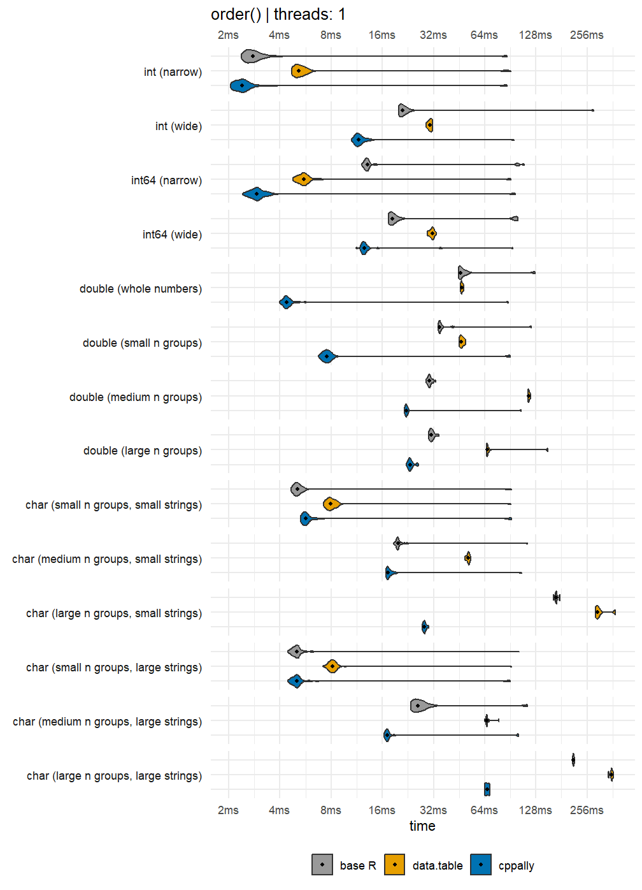
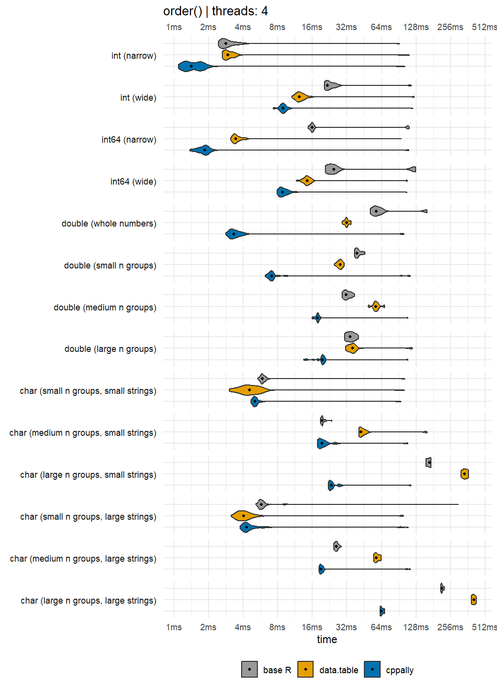
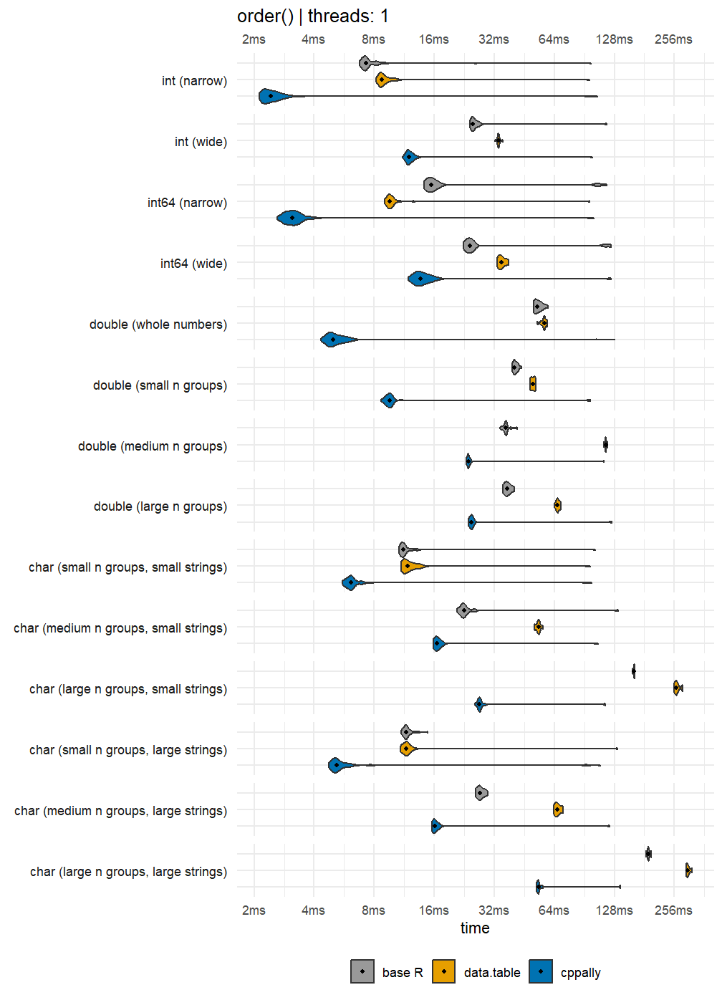
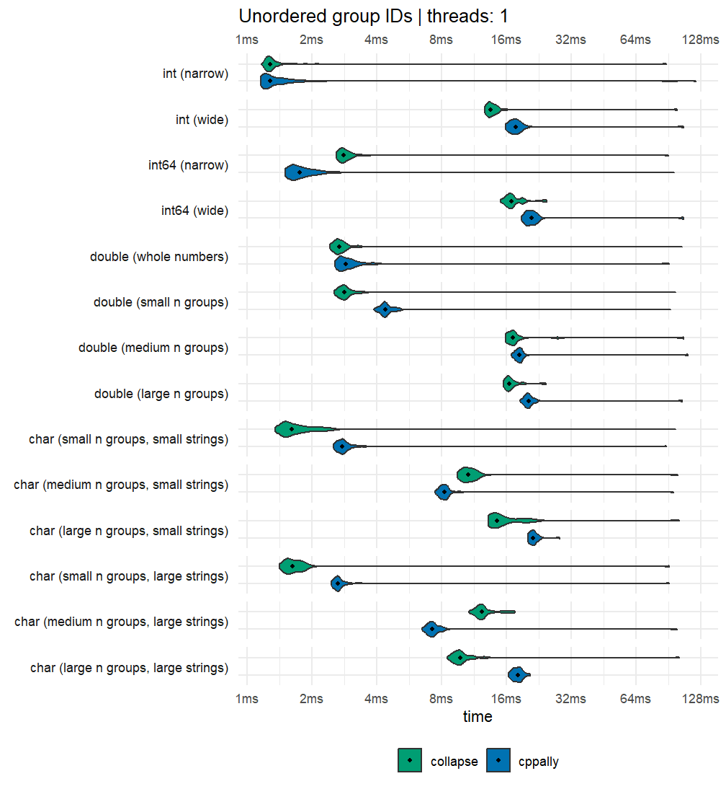
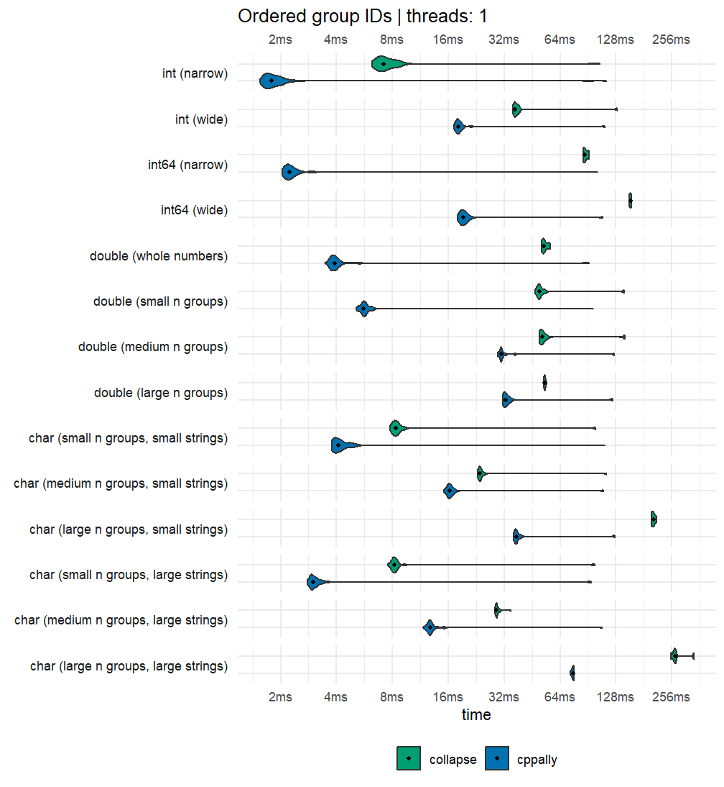
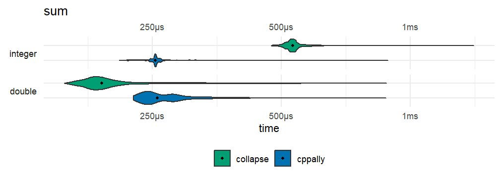
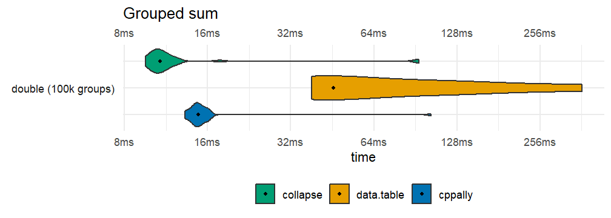

# Benchmarks

This vignette compares the speed of cppally sorting, group ID
generation, and statistical functions against base R, ‘data.table’, and
‘collapse’. Base R radix-sorting is already very fast, while the latter
two packages implement efficient grouped calculations. We will cover:

- Sorting
- Group IDs
- Statistical summaries
- Grouped statistical summaries

This vignette was built on a laptop with an Intel Core Ultra 5 125H (14
cores: 4 performance and 10 efficiency, 18 threads) and 16 GB of RAM,
running Windows 11 and R 4.6.0 on 17 Oct 2026.

## Setup

``` r

library(cppally)
library(bench)
library(ggplot2)
library(purrr)
library(data.table)
#> Warning: package 'data.table' was built under R version 4.6.1
#> data.table 1.18.6.1 using 9 threads (see ?getDTthreads).  Latest news: r-datatable.com
#> 
#> Attaching package: 'data.table'
#> 
#> The following object is masked from 'package:purrr':
#> 
#>     transpose
#> 
#> The following object is masked from 'package:base':
#> 
#>     %notin%
library(collapse)
#> Warning: package 'collapse' was built under R version 4.6.1
#> collapse 2.1.8, see ?`collapse-package` or ?`collapse-documentation`
#> 
#> Attaching package: 'collapse'
#> 
#> The following object is masked from 'package:data.table':
#> 
#>     fdroplevels
#> 
#> The following object is masked from 'package:stats':
#> 
#>     D
```

### Preamble

Sorting benchmarks are compared using multiple threads and a single
thread. All libraries are set to the same number of threads. Base R and
‘bit64’ are always single-threaded.

``` r

n <- 1e06

# CRAN machines are limited to 2 threads
max_threads <- if (nzchar(Sys.getenv("_R_CHECK_LIMIT_CORES_"))) 2L else 4L

set_threads_all <- function(n_threads){
  set_cppally_threads(n_threads)
  data.table::setDTthreads(n_threads)
  collapse::set_collapse(nthreads = n_threads)
}
old_collapse_threads <- collapse::get_collapse("nthreads")
old_dt_threads <- data.table::getDTthreads()

ggplot2::theme_set(theme_minimal())
```

[`bench::mark()`](https://bench.r-lib.org/reference/mark.html) is run
with `check = FALSE` since the outputs differ in ways that aren’t
important.
[`cppally::order()`](https://bit64.r-lib.org/reference/bit64S3.html) and
`cppally::make_groups()` return 0-indexed vectors. ‘collapse’ adds
attributes to group IDs and ‘data.table’ returns the group keys
alongside grouped results. We verify that cppally produces correct
results by checking them separately against base R, so that the timings
are not affected.

``` r

compare <- function(datasets, fns, threads = c(1L, max_threads)){
  lapply(
    threads,
    \(thread){
      set_threads_all(thread)
      press(
        data = names(datasets),
        {
          mark(
            exprs = lapply(fns, \(f) as.call(list(f, datasets[[data]]))),
            check = FALSE, min_iterations = 5, memory = FALSE, filter_gc = TRUE
          )
        },
        .quiet = TRUE
      )
    }
  ) |>
    setNames(paste("threads:", threads))
}

# Okabe-Ito colours
package_colours <- c(
  `base R` = "#999999",
  data.table = "#E69F00",
  collapse = "#009E73",
  cppally = "#0072B2"
)

plot_bench <- function(res, title){
  n_iter <- lengths(res$time)
  pkgs <- unique(as.character(res$expression))
  timings <- data.frame(
    package = factor(rep(as.character(res$expression), n_iter), levels = rev(pkgs)), # First package at the top
    data = factor(rep(res$data, n_iter), levels = unique(res$data)),
    time = as_bench_time(unlist(res$time))
  )
  ggplot(timings, aes(x = time, y = package, fill = package)) +
    geom_violin(scale = "width") +
    stat_summary(fun = median, geom = "point", orientation = "y", size = 1) +
    scale_x_bench_time(base = 2, breaks = \(lims) {
    ms <- as.numeric(lims) * 1e3
    2^(floor(log2(ms[1])):ceiling(log2(ms[2]))) / 1e3
  }, sec.axis = dup_axis(name = NULL, labels = \(x) trimws(format(as_bench_time(x))))) +
    scale_fill_manual(values = package_colours, breaks = pkgs) +
    facet_grid(rows = vars(data), switch = "y") +
    labs(title = title, x = "time", y = NULL, fill = NULL) +
    theme(
      axis.text.y = element_blank(), axis.ticks.y = element_blank(),
      strip.text.y.left = element_text(angle = 0, hjust = 1),
      strip.placement = "outside", legend.position = "bottom"
    )
}
```

## Sorting

``` cpp

template <RSortableVector T>
[[cppally::register]]
r_vector<r_int> cpp_order(T x){
  return order(x);
}
```

For base R we use `order(x, method = "radix", na.last = TRUE)`. For
‘data.table’ we use `data.table:::forderv(na.last = TRUE)`, and for
‘bit64’ and 64-bit integers, we use `bit64::order(na.last = TRUE)`.

### Benchmark data

``` r

set.seed(42)
benchmark_data <- list(
  `int (narrow)` = sample.int(100, n, replace = TRUE),
  `int (wide)` = sample.int(10^9, n, replace = TRUE),
  `int64 (narrow)` = bit64::as.integer64(sample.int(100, n, replace = TRUE)),
  `int64 (wide)` = bit64::as.integer64(sample.int(10^9, n, replace = TRUE)),
  `double (whole numbers)` = round(rnorm(n)) + 0,
  `double (small n groups)` = round(rnorm(n), 1) + 0,
  `double (medium n groups)` = round(rnorm(n), 5) + 0,
  `double (large n groups)` = rnorm(n) + 0,
  `char (small n groups, small strings)` = paste0(round(rnorm(n), 1)),
  `char (medium n groups, small strings)` = paste0(sample.int(1e05, n, replace = TRUE)),
  `char (large n groups, small strings)` = paste0(sample.int(1e07, n, replace = TRUE)),
  `char (small n groups, large strings)` = paste0(sample(round(rnorm(100), 8), n, replace = TRUE)),
  `char (medium n groups, large strings)` = paste0(sample(round(rnorm(1e05), 8), n, replace = TRUE)),
  `char (large n groups, large strings)` = paste0(round(rnorm(n), 8))
)
invisible(gc())
```

### Sort functions

``` r

sort_fns <- list(
  `base R` = \(x) if (inherits(x, "integer64")) bit64::order(x, na.last = TRUE) else order(x, method = "radix", na.last = TRUE),
  data.table = \(x) data.table:::forderv(x, na.last = TRUE),
  cppally = cpp_order
)
```

First let’s see whether cppally gives the correct order for each
dataset.

``` r

for (d in benchmark_data){
  is_identical <- identical(cpp_order(d) + 1L, sort_fns$`base R`(d))
  if (!is_identical){
    stop("Not identical, please check")
  }
}
rm(d)
invisible(gc())
```

All good, so we can now do the comparisons without re-checking.

### Sorting benchmarks

``` r

single_threaded_sort_comparisons <- compare(benchmark_data, sort_fns, threads = 1L)
invisible(gc())
multi_threaded_sort_comparisons <- compare(benchmark_data, sort_fns, threads = max_threads)
purrr::iwalk(single_threaded_sort_comparisons,
     \(res, nm){
       res |>
         plot_bench(paste("order()", "|", nm)) |>
         print()
     })
```



``` r

purrr::iwalk(multi_threaded_sort_comparisons,
     \(res, nm){
       res |>
         plot_bench(paste("order()", "|", nm)) |>
         print()
     })
```



### Data with NAs

It would also be useful to see the same comparisons but for data with
lots of NAs.

``` r

# Fill data with 20% NAs
benchmark_data_with_nas <- lapply(benchmark_data, \(x){
  x[sample.int(length(x), floor(length(x) * 0.2))] <- NA
  x
})
```

Let’s re-confirm that cppally produces correct results.

``` r

for (d in benchmark_data_with_nas){
  is_identical <- identical(cpp_order(d) + 1L, sort_fns$`base R`(d))
  if (!is_identical){
    stop("Not identical, please check")
  }
}
rm(d)
invisible(gc())
```

### Sorting benchmark on NA-filled data

``` r

single_threaded_sort_comparisons <- compare(benchmark_data_with_nas, sort_fns, threads = 1L)
invisible(gc())
multi_threaded_sort_comparisons <- compare(benchmark_data_with_nas, sort_fns, threads = max_threads)
purrr::iwalk(single_threaded_sort_comparisons,
     \(res, nm){
       res |>
         plot_bench(paste("order()", "|", nm)) |>
         print()
     })
```



``` r

purrr::iwalk(multi_threaded_sort_comparisons,
     \(res, nm){
       res |>
         plot_bench(paste("order()", "|", nm)) |>
         print()
     })
```


## Group IDs

``` cpp

template <RVector T>
[[cppally::register]]
r_vector<r_int> cpp_group_id(T x, bool ordered){
  return make_groups(x, ordered).ids;
}
```

`make_groups()` creates a C++ class `groups`, which holds group IDs of
the data, the number of unique groups, and other useful group metadata.
Unordered IDs assign group IDs by order-of-first-appearance, while
ordered group IDs assign them in sorted order. We compare unordered
group IDs against `collapse::group()` and ordered group IDs against
`collapse::GRP()`.

Unordered group ID correctness check

``` r

for (d in benchmark_data){
  is_identical <- identical(cpp_group_id(d, ordered = FALSE) + 1L, as.integer(collapse::group(d)))
  if (!is_identical){
    stop("Not identical, please check")
  }
}
rm(d)
invisible(gc())
```

### Unordered group IDs

``` r

unordered_group_id_comparisons <- compare(
  benchmark_data,
  list(
    collapse = \(x) collapse::group(x),
    cppally = \(x) cpp_group_id(x, ordered = FALSE)
  ),
  threads = 1L
)

purrr::iwalk(
  unordered_group_id_comparisons,
  \(res, nm){
    res |>
      plot_bench(paste("Unordered group IDs", "|", nm)) |>
      print()
  }
)
```



Ordered group ID correctness check

``` r

for (d in benchmark_data){
  is_identical <- identical(cpp_group_id(d, ordered = TRUE) + 1L, as.integer(collapse::GRP(d, sort = TRUE)$group.id))
  if (!is_identical){
    stop("Not identical, please check")
  }
}
rm(d)
invisible(gc())
```

### Ordered group IDs

``` r

ordered_group_id_comparisons <- compare(
  benchmark_data,
  list(
    collapse = \(x) collapse::GRP(x, sort = TRUE, return.order = FALSE, return.groups = FALSE)$group.id,
    cppally = \(x) cpp_group_id(x, ordered = TRUE)
  ),
  threads = 1L
)

purrr::iwalk(
  ordered_group_id_comparisons,
  \(res, nm){
    res |>
      plot_bench(paste("Ordered group IDs", "|", nm)) |>
      print()
  }
)
```



## Statistical summaries

``` cpp

template <RNumber T>
[[cppally::register]]
r_dbl cpp_sum(r_vector<T> x){
  return as<r_dbl>(sum(x, /*na_rm = */ true));
}

template <RNumber T>
[[cppally::register]]
T cpp_min(r_vector<T> x){
  return range(x, /*na_rm = */ true).get(0);
}

template <RNumber T>
[[cppally::register]]
r_dbl cpp_var(r_vector<T> x){
  return var(x, /*na_rm = */ true);
}

template <RNumber T>
[[cppally::register]]
r_vector<r_dbl> cpp_quantile(r_vector<T> x, r_vector<r_dbl> probs){
  return quantile(x, probs, /*na_rm = */ true, /*names = */ false);
}
```

For the statistical and grouped statistical summaries we will use 1
thread.

``` r

set_threads_all(1)
```

We compare against the ‘collapse’ equivalents `fsum()`, `fmin()`,
`fvar()` and `fquantile()`.

``` r

set.seed(42)
stat_data <- list(
  integer = sample.int(100, n, replace = TRUE),
  double = rnorm(n)
)
probs <- c(0.1, 0.5, 0.9)

stat_fns <- list(
  sum = list(
    collapse = \(x) collapse::fsum(x, na.rm = TRUE),
    cppally = cpp_sum
  ),
  min = list(
    collapse = \(x) collapse::fmin(x, na.rm = TRUE),
    cppally = cpp_min
  ),
  variance = list(
    collapse = \(x) collapse::fvar(x, na.rm = TRUE),
    cppally = cpp_var
  ),
  quantiles = list(
    collapse = \(x) collapse::fquantile(x, probs, na.rm = TRUE, names = FALSE),
    cppally = \(x) cpp_quantile(x, probs)
  )
)

for (stat in names(stat_fns)){
  p <- compare(stat_data, stat_fns[[stat]], threads = 1L) |>
    pluck(1) |>
    plot_bench(stat)
  print(p)
}
```



## Grouped statistical summaries

``` cpp

[[cppally::register]]
r_vector<r_dbl> grouped_sum(r_vector<r_dbl> x, r_vector<r_int> g){
  groups grps = make_groups(g, /*ordered = */ true);
  return apply_by_group(x, grps, [](const r_vector<r_dbl>& chunk){
    return sum(chunk, /*na_rm = */ true);
  });
}

[[cppally::register]]
r_vector<r_dbl> grouped_min(r_vector<r_dbl> x, r_vector<r_int> g){
  groups grps = make_groups(g, /*ordered = */ true);
  return apply_by_group(x, grps, [](const r_vector<r_dbl>& chunk){
    return range(chunk, /*na_rm = */ true).get(0);
  });
}

[[cppally::register]]
r_vector<r_dbl> grouped_var(r_vector<r_dbl> x, r_vector<r_int> g){
  groups grps = make_groups(g, /*ordered = */ true);
  return apply_by_group(x, grps, [](const r_vector<r_dbl>& chunk){
    return var(chunk, /*na_rm = */ true);
  });
}

[[cppally::register]]
r_vector<r_dbl> grouped_quantile(r_vector<r_dbl> x, r_vector<r_int> g, double prob){
  groups grps = make_groups(g, /*ordered = */ true);
  return apply_by_group(x, grps, [prob](const r_vector<r_dbl>& chunk){
    return quantile(chunk, prob, /*na_rm = */ true);
  });
}
```

Here each benchmark takes a vector `x` and a vector of groups `g`. It
then returns one result per group, in sorted group order. Therefore the
time it takes to build the groups into a format each distinct library
can handle is part of the benchmark.

- ‘collapse’ uses `fsum()`, `fmin()`, `fvar()` and `fmedian()`
- ‘data.table’ uses `[` with `keyby`, where sum, min, max, variance and
  median are all optimised internally (via GForce)
- cppally uses `apply_by_group()` as shown above

**Note:** `apply_by_group()` is a generic functional that accepts any
C++ function (lambda). This means that it is expected to be **slower**
than a hand-written optimised method. If it can achieve speeds that are
similar in magnitude to the hand-written ones, then that is more than
good enough given that it is meant to be generic.

``` r

set.seed(42)
x <- rnorm(n)
g <- sample.int(10^5, n, replace = TRUE)

grouped_data <- list(
  `double (100k groups)` = list(x = x, g = g, dt = data.table(x = x, g = g))
)

grouped_fns <- list(
  sum = list(
    collapse = \(d) collapse::fsum(d$x, d$g, na.rm = TRUE, use.g.names = FALSE),
    data.table = \(d) d$dt[, sum(x, na.rm = TRUE), keyby = g],
    cppally = \(d) grouped_sum(d$x, d$g)
  ),
  min = list(
    collapse = \(d) {
        collapse::fmin(d$x, d$g, na.rm = TRUE, use.g.names = FALSE)
    },
    data.table = \(d) d$dt[, .(min(x, na.rm = TRUE)), keyby = g],
    cppally = \(d) grouped_min(d$x, d$g)
  ),
  variance = list(
    collapse = \(d) collapse::fvar(d$x, d$g, na.rm = TRUE, use.g.names = FALSE),
    data.table = \(d) d$dt[, var(x, na.rm = TRUE), keyby = g],
    cppally = \(d) grouped_var(d$x, d$g)
  ),
  median = list(
    collapse = \(d) collapse::fmedian(d$x, d$g, na.rm = TRUE, use.g.names = FALSE),
    data.table = \(d) d$dt[, median(x, na.rm = TRUE), keyby = g],
    cppally = \(d) grouped_quantile(d$x, d$g, 0.5)
  )
)

for (stat in names(grouped_fns)){
  p <- compare(grouped_data, grouped_fns[[stat]], threads = 1L) |>
    pluck(1) |>
    plot_bench(paste("Grouped", stat))
  print(p)
}
```



## Session details

``` r

collapse::set_collapse(old_collapse_threads)
data.table::setDTthreads(old_dt_threads)
set_cppally_threads(1L)

data.frame(
  package = c("cppally", "data.table", "collapse", "bit64"),
  version = vapply(
    c("cppally", "data.table", "collapse", "bit64"),
    \(pkg) as.character(packageVersion(pkg)), ""
  )
) |>
  knitr::kable(row.names = FALSE)
```

| package    | version    |
|:-----------|:-----------|
| cppally    | 1.1.0.9000 |
| data.table | 1.18.6.1   |
| collapse   | 2.1.8      |
| bit64      | 4.8.6      |

``` r

R.version.string
#> [1] "R version 4.6.0 (2026-04-24 ucrt)"
```
